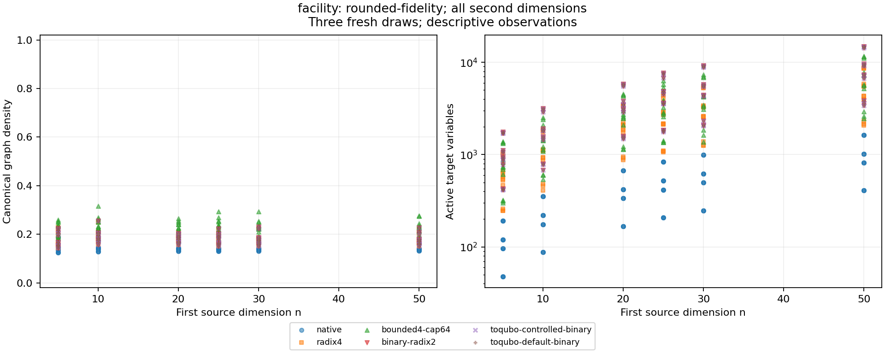
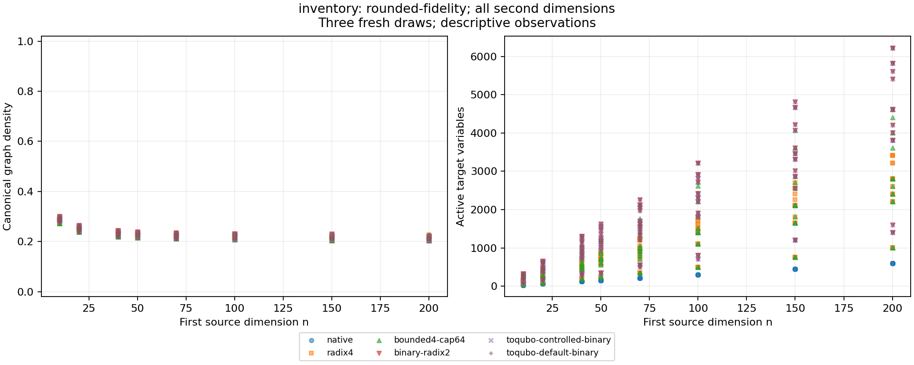
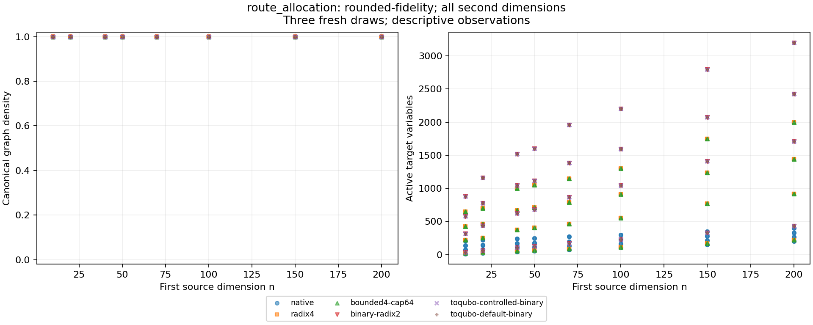
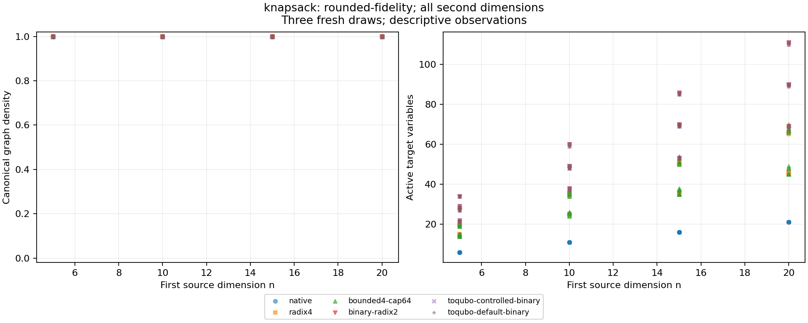
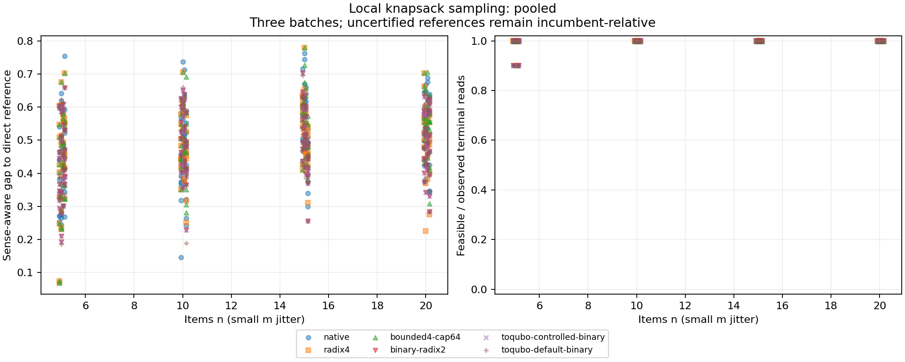

# Fresh quadratic case study

This report uses fresh synthetic instances and current exact integer encodings. It reports local software experiments; physical-provider replication remains pending.

Executable source: `ca326edbdcfed78c8fc4335069c079887d54f6c4`. Protocol SHA-256: `c99ae179dd7de1d426ea99400dc25857c8bb8c54d9c283253bdd5c52264af180`.

Coverage: 456 source profiles; 3132 terminal cells of 3,132 planned (2,736 structural and 396 direct). Statuses: `{'measured': 3132}`. Verified chains: 8640/8,640; unaudited: 0. Completed proposals: 34,560,000 of 34,560,000 reserved.

All planned software cells were measured and all planned chains retained and verified.

**Resource conformance is qualified.** Measurement completion does not certify continuous enforcement of the intended no-swap limit. A live kernel allowance discrepancy was observed and corrected without restarting the worker. A later read-only lifetime counter supports no recorded cgroup swap usage through `2026-10-15T15:21:16.610524+00:00` (conservative observation start), since creation of the original worker cgroup. This concerns that cgroup and its descendants, not host-wide swap activity or the later unfinished campaign. Continuous enforcement of the configured no-swap limit between the earlier observations remains unverified.

The conservative UTC interval is `2026-10-15T10:29:00+00:00` through `2026-10-15T11:46:47.385764+00:00`. It potentially overlaps 309 cells and 540 chains. Timings involving these records, including pooled tables and first-feasibility figures below, carry this qualification. Every chain of an overlapping parent cell is conservatively included; separate chain UTC boundaries are unavailable. Original statuses, values and proposal counts remain unchanged.

[Cell associations](resource-conformance/resource-conformance-cells.csv), [chain associations](resource-conformance/resource-conformance-chains.csv), and [hashed provenance](resource-conformance/resource-conformance-summary.json) identify the affected records. The deviation does not establish a mathematical or sampler defect and is not presented as full resource-protocol conformance.

**Deadline conformance is qualified.** Continuous host enforcement of phase and campaign deadlines during the recorded supervision gaps cannot be certified. The original worker was adopted without restarting it or resetting deadlines; measurement completion does not retrospectively establish watchdog coverage.

The union of the recorded closed UTC intervals potentially overlaps 98 cells and 0 chains. Every chain of an overlapping parent is conservatively included. Timings involving these records, including pooled tables and first-feasibility figures, carry this qualification separately from any memory/swap qualification. Original measurement statuses, values and proposal counts remain unchanged.

[Cell associations](supervision-conformance/supervision-conformance-cells.csv), [chain associations](supervision-conformance/supervision-conformance-chains.csv), and [hashed provenance and gap intervals](supervision-conformance/supervision-conformance-summary.json) identify the affected records and bind the recovery observations and exact executed controller sources. This is a qualified protocol deviation, not full deadline conformance.

**The original archive-size budget failed.** The first lossless packing attempt reached the frozen 512 MiB compressed cap and stopped before completing the archive. A paired real-record probe found XZ preset 9 larger than preset 6; the archive retains preset 6. A separately frozen postmeasurement amendment allows 1024 MiB of compressed parts to retain all original observations. The producing protocol and measurements remain unchanged. Original packaging-budget conformance remains failed; this amendment is not a measurement rerun.

The packet index and independent archive verification must establish final size, complete member integrity, report/plot parity and replay under the amended allowance. `full_execution` describes measurement coverage only. Hash-bound failure and probe provenance is retained at `processes/packaging-conformance.json` after extraction.

Source feasibility screens/witnesses: `{'capacity-infeasible': 6, 'source-feasible': 450}`. Capacity-infeasible facility draws are retained without replacement; they have no source optimum.

## Structural comparisons

Rows pool the stated grids and three fresh draws within each profile. Medians are descriptive; a single compilation per cell does not establish statistically significant speedups. Conversion includes all applicable compiler stages and extraction; source construction is separate. Density uses active unordered couplers, and coefficient ratios use canonical nonzero coefficients. A lower variable count or coefficient ratio alone does not prove better optimization performance.

### facility: rounded-fidelity

| Arm | Measured / planned | Median active variables | Median density | Median conversion s | Median coefficient ratio |
|---|---:|---:|---:|---:|---:|
| native | 72 / 72 | 380 | 0.14076 | 0.016121 | 3.5075e+15 |
| radix4 | 72 / 72 | 1984 | 0.18122 | 0.14271 | 3.9045e+15 |
| bounded4-cap64 | 72 / 72 | 2517 | 0.22795 | 0.19458 | 3.9045e+15 |
| binary-radix2 | 72 / 72 | 3296 | 0.17925 | 0.28767 | 7.1674e+15 |
| toqubo-controlled-binary | 72 / 72 | 3296 | 0.17925 | 3.759 | 7.1674e+15 |
| toqubo-default-binary | 72 / 72 | 3296 | 0.17925 | 10.628 | 7.1251e+15 |

### inventory: rounded-fidelity

| Arm | Measured / planned | Median active variables | Median density | Median conversion s | Median coefficient ratio |
|---|---:|---:|---:|---:|---:|
| native | 144 / 144 | 182 | 0.23344 | 0.0044269 | 400 |
| radix4 | 144 / 144 | 742.5 | 0.22361 | 0.032123 | 25600 |
| bounded4-cap64 | 144 / 144 | 774.5 | 0.22226 | 0.033459 | 25600 |
| binary-radix2 | 144 / 144 | 1210.5 | 0.22412 | 0.05574 | 23871 |
| toqubo-controlled-binary | 144 / 144 | 1210.5 | 0.22412 | 0.35813 | 23871 |
| toqubo-default-binary | 144 / 144 | 1210.5 | 0.22412 | 5.5709 | 23871 |

### route_allocation: rounded-fidelity

| Arm | Measured / planned | Median active variables | Median density | Median conversion s | Median coefficient ratio |
|---|---:|---:|---:|---:|---:|
| native | 96 / 96 | 173 | 1 | 0.0024561 | 120.01 |
| radix4 | 96 / 96 | 603 | 1 | 0.02335 | 8192 |
| bounded4-cap64 | 96 / 96 | 603 | 1 | 0.027891 | 8192 |
| binary-radix2 | 96 / 96 | 964 | 1 | 0.045437 | 5184 |
| toqubo-controlled-binary | 96 / 96 | 964 | 1 | 0.96309 | 5184 |
| toqubo-default-binary | 96 / 96 | 964 | 1 | 20.076 | 5184 |

### route_allocation: unrounded-quadratic

| Arm | Measured / planned | Median active variables | Median density | Median conversion s | Median coefficient ratio |
|---|---:|---:|---:|---:|---:|
| native | 96 / 96 | 173 | 1 | 0.0023462 | 120 |
| radix4 | 96 / 96 | 603 | 1 | 0.025691 | 8192 |
| bounded4-cap64 | 96 / 96 | 603 | 1 | 0.027026 | 8192 |
| binary-radix2 | 96 / 96 | 964 | 1 | 0.045271 | 5184 |
| toqubo-controlled-binary | 96 / 96 | 964 | 1 | 1.0606 | 5184 |
| toqubo-default-binary | 96 / 96 | 964 | 1 | 21.988 | 5184 |

### knapsack: rounded-fidelity

| Arm | Measured / planned | Median active variables | Median density | Median conversion s | Median coefficient ratio |
|---|---:|---:|---:|---:|---:|
| native | 48 / 48 | 13.5 | 1 | 0.00056476 | 6140.4 |
| radix4 | 48 / 48 | 35 | 1 | 0.0026427 | 42419 |
| bounded4-cap64 | 48 / 48 | 35.5 | 1 | 0.0028331 | 41601 |
| binary-radix2 | 48 / 48 | 56 | 1 | 0.0031156 | 27650 |
| toqubo-controlled-binary | 48 / 48 | 56 | 1 | 0.0027067 | 27650 |
| toqubo-default-binary | 48 / 48 | 56 | 1 | 0.024863 | 27650 |

## Paired changes from native

Each change is computed within the same source profile before aggregation. Positive variable changes mean more target variables. The default ToQUBO arm also changes penalty/GCD policy. Exact polynomial aliases are identified by the same canonical polynomial/domain hash; source projection identity is checked separately.

| Arm | Measured pairs | Median active-variable change | Median conversion-time change s | Exact canonical aliases |
|---|---:|---:|---:|---:|
| native | 456 | 0 | 0 | 456 |
| radix4 | 456 | 480 | 0.021838 | 0 |
| bounded4-cap64 | 456 | 504 | 0.025255 | 0 |
| binary-radix2 | 456 | 884 | 0.042376 | 0 |
| toqubo-controlled-binary | 456 | 884 | 0.54207 | 0 |
| toqubo-default-binary | 456 | 884 | 7.9606 | 0 |

## Original-source solver references

The direct model is the original constrained integer quadratic problem. Numerical global solver optimality is distinct from exact exhaustive proof. Interrupted incumbents remain labeled as incumbents. The nonnegative route allocation model has an independent monotonicity certificate in both coefficient profiles.

| Family / profile | Retained cases | Solver termination counts | Independently feasible primals |
|---|---:|---|---:|
| facility / rounded-fidelity | 12 | {'OPTIMAL': 8, 'TIME_LIMIT': 4} | 12 |
| inventory / rounded-fidelity | 144 | {'OPTIMAL': 144} | 144 |
| knapsack / rounded-fidelity | 48 | {'OPTIMAL': 41, 'TIME_LIMIT': 7} | 48 |
| route_allocation / rounded-fidelity | 96 | {'OPTIMAL': 96} | 96 |
| route_allocation / unrounded-quadratic | 96 | {'OPTIMAL': 96} | 96 |

## Local knapsack sampling

Primary quality uses the best source-feasible **terminal independent read** per batch. Best-visited diagnostics and any-hit chains are separate. Every planned ten-read batch appears, including empty or interrupted batches. Observed feasibility divides by verified completed reads; missing reads are not failures. An incumbent-relative ratio may exceed one. First-feasible wall time is measured and hash-bound; proposal decisions and first-feasible work are replayed. No IID time-to-success estimate is inferred from correlated chain observations.

| Arm | Verified / planned reads | Feasible terminal reads / verified | Missing or unaudited | Batches with feasible terminal / planned | Median gap, numerically optimal references |
|---|---:|---:|---:|---:|---:|
| native | 1440 / 1440 | 1440 / 1440 | 0 | 144 / 144 | 0.50654 |
| radix4 | 1440 / 1440 | 1439 / 1440 | 0 | 144 / 144 | 0.49438 |
| bounded4-cap64 | 1440 / 1440 | 1439 / 1440 | 0 | 144 / 144 | 0.50909 |
| binary-radix2 | 1440 / 1440 | 1436 / 1440 | 0 | 144 / 144 | 0.49314 |
| toqubo-controlled-binary | 1440 / 1440 | 1436 / 1440 | 0 | 144 / 144 | 0.49314 |
| toqubo-default-binary | 1440 / 1440 | 1435 / 1440 | 0 | 144 / 144 | 0.48862 |

Per-replicate quality and observed first-feasibility/censoring plots accompany the raw tables.

## Mathematical and numerical limits

Exact affine interval coverage is checked for every compiled target. Independent exhaustive manufactured source/target fixtures establish optimum correspondence for integer/dyadic test cases. Three large-target Float64 energy checks are diagnostics rather than exhaustive proofs. Feasible-witness cancellation errors are retained in raw verification records; sufficient mathematical penalties do not eliminate floating-point rounding. A finite-budget sampler miss does not show that an exact integer encoding lost the optimum.

The rounded route profile has zero quadratic interactions for these grids; its separately labeled paired unrounded profile remains nonnegative and monotone. Facility and inventory matrices are not assumed PSD. Coefficient-matrix eigenvalue spacing and symmetric spectral conditioning describe the chosen canonical representation; neither is an optimization or quantum gap. Historical total widths are labeled separately from true domain-level counts.

## Reproduction

Verify and extract the packet with `pack.py extract`, regenerate tables with `report.py`, then run `analysis.py` and the pinned `plots.py` environment. These steps do not solve or sample. Run `replay.jl` to reproduce retained actual proposal decisions; elapsed wall times are not deterministically reproducible. The packet includes exact environment/source/protocol/input and raw-record hashes. Private process stdout and licensing configuration are excluded.
